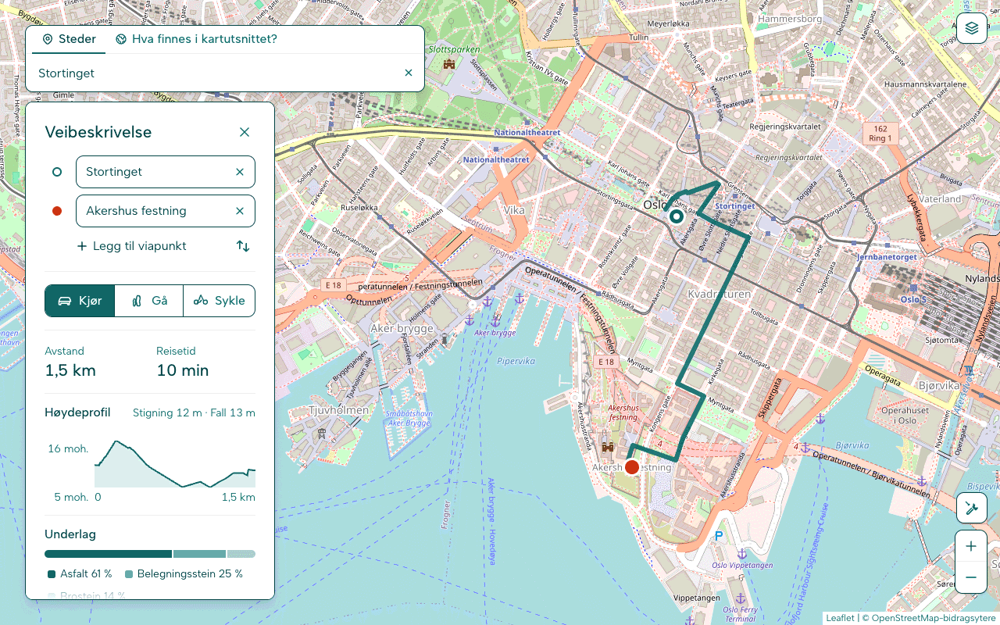

# OpenMaps

OpenMaps er en kartløsning du drifter selv. Du får et kart i nettleseren med stedssøk,
ruteplanlegging for bil, gange og sykkel, søk etter kartobjekter med vanlig tekst
(«kafeer», «ladestasjoner»), lag, oppmåling, lenker til kartutsnitt og gatebilder hvis du
har dem. Løsningen er to containere: en nettapp (React og Leaflet) og et API (FastAPI) som
sender søk, ruter og spørringer videre til karttjenestene du velger. Det kan være de
offentlige OpenStreetMap-tjenestene, for å prøve, eller dine egne. Grensesnittet er på norsk.



Ferdige bilder for amd64 og arm64 ligger på GitHub Container Registry:

- `ghcr.io/opensourcegeospatial/openmaps-frontend`
- `ghcr.io/opensourcegeospatial/openmaps-backend`

## Hurtigstart

Du trenger Docker med Compose v2. Oppsettet er testet med Compose v5.1. Noen
standardverdier i `compose.yml` inneholder `{…}`, og det krever en nyere Compose.

1. Hent koden og lag din egen `.env`:

   ```sh
   git clone https://github.com/opensourcegeospatial/openmaps.git
   cd openmaps
   cp .env.example .env
   ```

2. Åpne `.env` og fyll inn to verdier:

   - `HTTP_USER_AGENT`: navnet på installasjonen og en adresse du kan nås på, for eksempel
     `"OpenMaps (+mailto:deg@example.org)"`. De offentlige tjenestene avviser anonyme
     klienter. Bytt ut eksempeladressen.
   - `GRAPHHOPPER_API_KEY`: en API-nøkkel fra [graphhopper.com](https://www.graphhopper.com/).
     Gratisnivået holder for å prøve. Uten nøkkel får du en feilmelding i stedet for en rute.

3. Start:

   ```sh
   docker compose up -d
   ```

   Første gang lastes de ferdige bildene ned. Vil du heller bygge dem selv, kjør
   `docker compose up -d --build`.

4. Åpne <http://localhost:8080>.

Slik sjekker du at alt er oppe:

```sh
docker compose ps                         # begge tjenestene skal stå som «healthy»
curl http://localhost:8080/api/health     # status for hver karttjeneste
```

Den offentlige Overpass-tjenesten er ofte travel, så `/api/health` kan vise den som nede
selv om tekstsøk og kartobjekter som regel virker – prøv igjen litt senere.

Frontend starter når backend er klar, så det kan ta et halvt minutt.

Har du glemt `.env`, stopper Compose før noe starter. Meldingen nevner en av de fire
adressene `GEOCODE_URL`, `REVERSE_GEOCODE_URL`, `GRAPHHOPPER_URL` og `OVERPASS_API` (hvilken
av dem varierer). Kopier `.env.example` til `.env` og prøv igjen.

### De offentlige tjenestene er bare for å prøve

Hurtigstarten bruker gratis, delte tjenester. De er fine for å se hvordan OpenMaps virker,
men de er ikke laget for fast drift eller mange brukere.

| Tjeneste | Brukes til | Vilkår |
|---|---|---|
| Nominatim (`nominatim.openstreetmap.org`) | søk og adresseoppslag | Maks én forespørsel i sekundet, ingen autoutfylling, og hver klient må si hvem den er. [Retningslinjer](https://operations.osmfoundation.org/policies/nominatim/) |
| GraphHopper (`graphhopper.com`) | ruter | API-nøkkel. Gratisnivået har grenser per minutt og per døgn. |
| Overpass (`overpass-api.de`) | kartobjekter og tekstsøk | Rimelig bruk. Er tjenesten travel, avviser eller utsetter den spørringer. [Mer om tjenesten](https://wiki.openstreetmap.org/wiki/Overpass_API) |
| Kartfliser (`tile.openstreetmap.org`) | bakgrunnskartet | Lett bruk. [Retningslinjer](https://operations.osmfoundation.org/policies/tiles/) |

Med standardoppsettet følger OpenMaps ikke alle disse vilkårene:

- Søkefeltet søker 300 ms etter at du har sluttet å skrive. Det regnes som autoutfylling,
  og det tillater ikke retningslinjene for den offentlige Nominatim-tjenesten.
- Backend begrenser ikke søk til én i sekundet og mellomlagrer ikke svar.
- Uten `HTTP_USER_AGENT` sender alle installasjoner samme User-Agent (`OpenMaps/1.0`). Sett
  din egen, med en adresse du kan nås på.
- Nettappen sender ikke med noen Referer når den henter kartfliser (nginx setter
  `Referrer-Policy: same-origin`). `tile.openstreetmap.org` kan derfor avvise flisene
  (`403`), og da blir bakgrunnskartet tomt. Velg en annen flisetjeneste med `MAP_STYLES`,
  eller kjør din egen.

Til vanlig bruk peker du OpenMaps mot egne tjenester.

## Bruk egne karttjenester

OpenMaps har ingen kartdata selv. Backend sender forespørslene videre til adressene i `.env`.
Endre dem og kjør `docker compose up -d` igjen. Adressene må kunne nås fra
backend-containeren. `localhost` i en container er containeren selv, ikke maskinen din.

| Tjeneste | Variabler | Eksempel |
|---|---|---|
| Nominatim (søk og adresser) | `GEOCODE_URL`, `REVERSE_GEOCODE_URL` | `http://nominatim.example.org:8080/search` og `…/reverse` |
| Overpass (kartobjekter) | `OVERPASS_API` | `http://overpass.example.org/api/interpreter` |
| GraphHopper (ruter) | `GRAPHHOPPER_URL` | `http://graphhopper.example.org:8989/route` |

Egen GraphHopper:

- La `GRAPHHOPPER_API_KEY` stå tom. Nøkkelen trengs bare hos graphhopper.com.
- Fjern `graphhopper` fra `HEALTH_SKIP`, så følger helsesjekken med på tjenesten. Den
  hostede tjenesten har ikke noe `/health`, derfor står den i listen i `.env.example`.
- Profilene må hete `car`, `foot` og `bike`. Alternative ruter og områder å unngå bruker
  GraphHoppers fleksible modus (`ch.disable=true`).
- Høydeprofil og rutedetaljer (underlag, veitype og fartsgrense) vises når grafen din har
  dataene. Backend spør GraphHoppers `/info` om hva som finnes.

Egen Nominatim: `NOMINATIM_LANGUAGE` styrer hvilket språk stedsnavn kommer på.

### Bakgrunnskart

`MAP_STYLES` er en JSON-liste med bakgrunnskart. Hvert kart er et objekt med `id`, `name`,
`url` og `attribution`, og `url` bruker `{z}`, `{x}` og `{y}` (og eventuelt `{s}`). Med mer
enn ett kart får kartet en knapp for å bytte. Skriv hele verdien i enkle anførselstegn:

```sh
MAP_STYLES='[{"id":"osm","name":"OpenStreetMap","url":"https://tile.openstreetmap.org/{z}/{x}/{y}.png","attribution":"© OpenStreetMap-bidragsytere"},{"id":"egne","name":"Egne kartfliser","url":"https://fliser.example.org/{z}/{x}/{y}.png","attribution":"© OpenStreetMap-bidragsytere"}]'
```

Krediter kartdataene og flisetjenesten slik vilkårene deres krever. Teksten i
`attribution` vises i hjørnet av kartet.

Frontendens nginx sender også `/tiles/{z}/{x}/{y}.png` videre til stilen `basic-preview`
på en tileserver-gl som heter `tileserver` i samme Compose-prosjekt. Legger du til en slik
tjeneste (for eksempel i en `compose.override.yml`), kan et kart bruke
`"url":"/tiles/{z}/{x}/{y}.png"`. Vil du at helsesjekken skal følge med på den, fjerner du
`tileserver` fra `HEALTH_SKIP` og setter `TILESERVER_URL` hvis den ikke svarer på
`http://tileserver:8080`.

## Konfigurasjon

Alt stilles inn i `.env`. Compose leser filen og sender verdiene videre til containerne.
Hver variabel er forklart i `.env.example`. De fleste er kommentert ut og viser
standardverdien: fjern `#` for å endre en. Etter en endring kjører du `docker compose up -d`,
som lager containerne på nytt med de nye verdiene. Bare `BACKEND_WITH_ML` krever at du
bygger bildet på nytt.

### Karttjenester

| Variabel | Standard | Hva den gjør |
|---|---|---|
| `GEOCODE_URL` | må settes | Søk: Nominatims `/search`. |
| `REVERSE_GEOCODE_URL` | må settes | Adresseoppslag: Nominatims `/reverse`. |
| `GRAPHHOPPER_URL` | må settes | Ruter: GraphHoppers `/route`. |
| `OVERPASS_API` | må settes | Kartobjekter og tekstsøk: Overpass' `/api/interpreter`. |
| `GRAPHHOPPER_API_KEY` | tom | Nøkkel for graphhopper.com. Tom for egen GraphHopper. Vises og logges aldri. |
| `HTTP_USER_AGENT` | `OpenMaps/1.0` | Hvem forespørslene kommer fra. Sett navn og en adresse du kan nås på. |
| `NOMINATIM_LANGUAGE` | `nb,nn,no,en` | Språk for stedsnavn og adresser, i prioritert rekkefølge. |
| `TILESERVER_URL` | `http://tileserver:8080` | Flisetjenesten helsesjekken spør når `tileserver` ikke står i `HEALTH_SKIP`. |

### Bilder, porter og mapper

| Variabel | Standard | Hva den gjør |
|---|---|---|
| `OPENMAPS_VERSION` | `latest` | Versjonen av de ferdige bildene. Sett et versjonsnummer for å låse den. |
| `FRONTEND_PORT` | `8080` | Porten kartet åpnes på. `127.0.0.1:8080` gjør den bare tilgjengelig fra maskinen selv. |
| `BACKEND_PORT` | `8000` | Porten API-et publiseres på. Se [Kjør trygt](#kjør-trygt). |
| `BACKEND_WITH_ML` | `false` | `true` bygger backend med torch og transformers for den lokale modellen. Gjelder bare når du bygger selv. |
| `STREETVIEW_HOST_DIR` | `./streetview` | Mappen med gatebilder. Backend må kunne skrive i den (uid 1000). |

### Helsesjekk og systemhelse

| Variabel | Standard | Hva den gjør |
|---|---|---|
| `HEALTH_SKIP` | se under | Sjekker `/health` hopper over, kommaseparert. Navnene er `tileserver`, `nominatim`, `overpass`, `graphhopper`, `nominatim-ui`, `overpassbot`, `overpass-ultra`, `graphhopper-maps` og `llm`. |
| `HEALTH_CHECK_TIMEOUT` | `5` | Tidsgrense per sjekk, i sekunder. |
| `HEALTH_CACHE_SECONDS` | `5` | Hvor lenge et resultat gjenbrukes, i sekunder. |
| `HEALTH_DASHBOARD_ENABLED` | `true` | Systemhelse-panelet. Åpne appen med `?health` i adressen, eller trykk Alt+Shift+H. `false` slår det av. |

Uten `HEALTH_SKIP` i `.env` hopper `compose.yml` over
`tileserver,nominatim-ui,overpassbot,overpass-ultra,graphhopper-maps`: tjenester dette
oppsettet ikke har. `.env.example` legger til `graphhopper`, fordi den hostede
GraphHopper-tjenesten ikke har noe `/health`.

### Logging og grenser

| Variabel | Standard | Hva den gjør |
|---|---|---|
| `LOG_LEVEL` | `INFO` | `DEBUG`, `INFO`, `WARNING` eller `ERROR`. |
| `LOG_FORMAT` | `json` | `json` (én linje per hendelse) eller `text`. |
| `ROUTING_MAX_ALTERNATIVES` | `3` | Flest alternative ruter (2–6). |
| `MAX_ROUTE_WAYPOINTS` | `25` | Flest viapunkter i en rute (1–100). |
| `OVERPASS_MAX_BBOX_AREA` | `4` | Største område et tekstsøk kan dekke, i kvadratgrader. |
| `OVERPASS_MAXSIZE_BYTES` | `33554432` | Største svar Overpass kan gi på et tekstsøk, i byte (32 MiB). |
| `OVERPASS_MAX_CONCURRENT_INFERENCES` | `1` | Tekstsøk den lokale modellen kan kjøre samtidig. |
| `OVERPASS_MAX_GENERATION_SECONDS` | `30` | Lengste tid den lokale modellen får per tekstsøk, i sekunder. |

### Tekstsøk i kartobjekter

| Variabel | Standard | Hva den gjør |
|---|---|---|
| `OVERPASS_GENERATOR` | `auto` | `auto`, `llm`, `byt5` (lokal modell) eller `keyword`. `auto` velger språkmodellen når den er satt opp, ellers den lokale modellen hvis den er lastet, ellers nøkkelordsøk. |
| `LLM_BASE_URL` | tom | Adressen til et OpenAI-kompatibelt chat-API, for eksempel `https://llm.example.org/v1`. |
| `LLM_MODEL` | tom | Modellnavnet hos tjenesten, for eksempel `llama3.1:8b`. |
| `LLM_API_KEY` | tom | Nøkkelen. Sendes bare som bearer-token, og vises og logges aldri. |
| `LLM_TIMEOUT_SECONDS` | `30` | Tidsgrense for svaret. Etter det tar nøkkelordsøket over. |
| `LLM_MAX_TOKENS` | `200` | Flest tokens modellen kan svare med. |
| `LLM_MAX_CONCURRENT` | `4` | Flest samtidige forespørsler til språkmodellen. |
| `MODEL_DIR` | `/app/models/byt5-base_com08` | Mappen i containeren med den lokale modellen. |
| `TORCH_NUM_THREADS` | tom | Tråder for den lokale modellen. Tom gir én per CPU-kjerne. |

### Gatebilder

| Variabel | Standard | Hva den gjør |
|---|---|---|
| `STREETVIEW_ENABLED` | `false` | Hovedbryteren. `true` når du har lagt inn panoramabilder. |
| `STREETVIEW_INDEX_ON_START` | `true` | Backend bygger `panoramas.json` ved oppstart når den mangler eller er utdatert. |
| `STREETVIEW_GEOJSON_URL` | `/api/streetview/panoramas` | Hvor nettleseren henter punktene. |
| `STREETVIEW_PANORAMA_URL` | `/api/streetview/panorama/{id}` | Hvor nettleseren henter ett bilde. |
| `STREETVIEW_TILES_URL` | tom | Har ingen virkning i dette oppsettet. Kartet tegner ikke kartfliser med punktene. Adressen brukes bare til å lage en GeoJSON-adresse når `STREETVIEW_GEOJSON_URL` er tom, og Compose fyller alltid inn den. |
| `STREETVIEW_SOURCE_LAYER` | `panoramas` | Har ingen virkning i dette oppsettet. Navnet på laget i kartflisene, som ikke brukes. |
| `STREETVIEW_METADATA_URL` | tom | Adresse for metadata om ett panorama. Tom betyr ikke i bruk. |
| `STREETVIEW_MIN_ZOOM` | `12` | Laveste zoomnivå punktene vises på. |
| `STREETVIEW_MAX_ZOOM` | `18` | Høyeste zoomnivå punktene vises på. Zoomer du lenger inn, skjules de. |
| `STREETVIEW_CIRCLE_COLOR`, `STREETVIEW_CIRCLE_STROKE_COLOR` | tom | Farge på punktene og kanten deres. Tom følger temaet. |
| `STREETVIEW_CIRCLE_RADIUS`, `STREETVIEW_CIRCLE_STROKE_WIDTH` | `6`, `2` | Størrelse på punktene og kanten, i piksler. |
| `STREETVIEW_CIRCLE_OPACITY` | `0.85` | Hvor dekkende punktene er (0–1). |
| `STREETVIEW_BOUNDS` | tom | Området bildene ligger i: `[vest,sør,øst,nord]` i grader. Punktene hentes bare når kartet viser noe av området. Tom betyr alltid. |

### Kartet

| Variabel | Standard | Hva den gjør |
|---|---|---|
| `MAP_DEFAULT_ZOOM` | `12` | Zoomnivået kartet åpner på. |
| `MAP_DEFAULT_LAT`, `MAP_DEFAULT_LNG` | `59.9127`, `10.7446` | Midtpunktet kartet åpner på (Oslo). |
| `MAP_STYLES` | OpenStreetMap-fliser | Bakgrunnskartene. Se [Bakgrunnskart](#bakgrunnskart). |
| `API_NOMINATIM_SEARCH_URL` | `/api/search` | Hvor nettleseren søker. |
| `API_NOMINATIM_REVERSE_URL` | `/api/reverse` | Hvor nettleseren slår opp adresser. |
| `API_GRAPHHOPPER_URL` | `/api/route` | Hvor nettleseren henter ruter. |
| `API_OVERPASS_URL` | `/api/overpass` | Hvor nettleseren sender tekstsøk. |

`API_*` er relative stier som frontendens nginx sender videre til backend. De trenger
sjelden endres.

### Farger

Alle verdier er fargekoder på formen `#rrggbb`. Tomme verdier gir den innebygde paletten.
Velg farger som er mørke nok til at hvit tekst er lesbar på knapper.

| Variabel | Hva den gjør |
|---|---|
| `THEME_PRIMARY` | Hovedfargen. Gir lyse og mørke nyanser i grensesnittet og farger ruten, startmarkøren og valgte objekter. Ofte det eneste du trenger. |
| `THEME_SUCCESS`, `THEME_DANGER`, `THEME_WARNING` | Statusfarger. |
| `THEME_NEUTRAL`, `THEME_BACKGROUND`, `THEME_SURFACE`, `THEME_TEXT`, `THEME_BORDER` | Nøytrale flater i lyst tema. Mørkt tema beholder sine egne. |
| `THEME_ROUTE_PRIMARY`, `THEME_ROUTE_ALTERNATIVE` | Valgt rute og alternative ruter. |
| `THEME_MARKER_FROM`, `THEME_MARKER_TO`, `THEME_MARKER_WAYPOINT` | Markørene for start, mål og viapunkter. |
| `THEME_AVOID` | Områder ruten skal unngå. |
| `THEME_FEATURE_SELECTED` | Valgte kartobjekter. |

## Valgfrie funksjoner

### Gatebilder

Gatebilder er av til du slår dem på, og det følger ingen bilder med. Du legger inn dine egne
360°-bilder.

1. På Linux: mappen må tilhøre brukeren backend kjører som (uid 1000). Har du startet
   OpenMaps før, har Docker allerede laget `./streetview` som root, og da kan ikke backend
   skrive `panoramas.json`. Kommandoene under virker både før og etter første start:

   ```sh
   sudo mkdir -p streetview/panoramas
   sudo chown -R 1000:1000 streetview
   ```

   Er ikke din egen bruker uid 1000, legger du bildene inn med `sudo`.

2. Legg bildene i `streetview/panoramas/`. De må være ekvirektangulære 360°-bilder i
   formatet `.jpg`, `.jpeg`, `.png` eller `.webp`. Hvert bilde trenger en JSON-fil med samme
   navn ved siden av seg, for eksempel `operaen.jpg` og `operaen.json`:

   ```json
   {
     "lat": 59.9075,
     "lon": 10.7531,
     "heading": 90,
     "address": "Operaen, Oslo",
     "date": "2026-05-17"
   }
   ```

3. Sett `STREETVIEW_ENABLED=true` i `.env` og kjør:

   ```sh
   docker compose up -d
   docker compose restart backend
   ```

   `up -d` gir frontend den nye innstillingen. `restart backend` får backend til å lese inn
   bildene, for den bygger `panoramas.json` bare når den starter. Punktene vises på kartet
   fra zoomnivå 12 til og med 18 (`STREETVIEW_MIN_ZOOM` og `STREETVIEW_MAX_ZOOM`).

Feltene i JSON-filen:

| Felt | Påkrevd | Betydning |
|---|---|---|
| `lat`, `lon` | ja | Hvor bildet er tatt, i desimalgrader. |
| `id` | nei | Id-en bildet hentes med. Standard er filnavnet uten endelse. Bare bokstavene a–z og A–Z, sifre, `_` og `-` er lov, ellers kan ikke bildet hentes. |
| `heading` | nei | Retningen visningen starter i, i grader fra midten av bildet. Standard er `0`. |
| `address` eller `name` | nei | Navnet på panoramaet. Står begge, brukes `address`. Standard er filnavnet uten endelse. |
| `date` | nei | Når bildet er tatt, for eksempel `2026-05-17`. Tas med i `panoramas.json`. |
| `elevation` | nei | Høyde i meter. Tas med i `panoramas.json`. |

Backend bygger `streetview/panoramas.json` når den starter, hvis filen mangler eller er eldre
enn bildene. Legger du til flere bilder senere, kjør `docker compose restart backend` igjen.
Bilder uten JSON-fil eller uten `lat` og `lon` hoppes over. Loggen sier hvilke og hvorfor:
`docker compose logs backend`. Står det `unwritable` der, kan ikke backend skrive i mappen
(se punkt 1).

Hvor du får bilder: ta dem selv med et 360°-kamera, eller bruk bilder fra
[Mapillary](https://www.mapillary.com/). De er lisensiert under CC BY-SA 4.0, så du må
kreditere dem og dele videre på samme vilkår. Ikke hent bilder fra kommersielle
kartleverandører. Vilkårene deres tillater ikke det.

### Tekstsøk med en språkmodell

Tekstsøket gjør en beskrivelse som «bensinstasjoner» om til en Overpass-spørring. Uten
oppsett bruker det et enkelt nøkkelordsøk som kjenner vanlige norske ord som «skole»,
«apotek» og «parkering». En språkmodell gir bedre svar. Sett alle tre i `.env`:

```sh
LLM_BASE_URL=https://llm.example.org/v1
LLM_MODEL=llama3.1:8b
LLM_API_KEY=nøkkelen-din
```

Alle tjenester med et OpenAI-kompatibelt chat-API (`/chat/completions`) fungerer. Et
eksempel er Ollama, med `LLM_BASE_URL=http://<maskin>:11434/v1`. Ollama sjekker ikke
nøkkelen, men OpenMaps krever at `LLM_API_KEY` er satt, så skriv hva som helst. Ollama må
lytte på en adresse containeren når, for eksempel med `OLLAMA_HOST=0.0.0.0`.

Med `OVERPASS_GENERATOR=auto` (standard) tas språkmodellen i bruk når alle tre er satt.
Svarer den ikke innen `LLM_TIMEOUT_SECONDS`, tar nøkkelordsøket over. Søketeksten sendes
til tjenesten du velger. Hvilken generator som er i bruk, ser du med
`curl http://localhost:8080/api/config`.

### Lokal modell

Backend kan også kjøre en egen ByT5-modell på CPU i containeren. Ingen modell følger med, og
du må selv sjekke lisensen til modellen du bruker.

1. Sett `BACKEND_WITH_ML=true` i `.env` og bygg backend: `docker compose build backend`.
   Bildet blir mye større (torch og transformers). Det får samme navn som det ferdige bildet,
   så ikke kjør `docker compose pull` etterpå.
2. Legg modellen i `./models/byt5-base_com08/`, eller sett `MODEL_DIR`. Det må være en
   T5-modell i Hugging Face-format (konfigurasjon, vekter og tokenizer). Den lastes bare fra
   disk.
3. Aktiver linjen `./models:/app/models:ro` under `volumes` for `backend` i `compose.yml`.
4. Kjør `docker compose up -d`.

Modellen lastes i bakgrunnen. Til den er klar, svarer nøkkelordsøket. Med
`OVERPASS_GENERATOR=auto` brukes den lokale modellen når ingen språkmodell er satt opp.
`TORCH_NUM_THREADS` og `OVERPASS_MAX_*` styrer hvor mye CPU den får.

## Kjør trygt

OpenMaps har ingen innlogging. Kjør det på et nett du stoler på, eller bak en egen
omvendt proxy med innlogging (for eksempel nginx, Caddy eller Traefik med passord eller
enkel pålogging). Ikke gjør portene tilgjengelige fra internett slik de er.

Grunnen:

- Uten innlogging kan alle som når portene, bruke kartet og API-et.
- API-et tillater forespørsler fra alle nettsteder (CORS `*`). Da kan hvilken som helst
  nettside bruke din backend gjennom nettleserne til dem som besøker den.
- Backend-porten (`BACKEND_PORT`, standard `8000`) publiseres på alle nettverkskort, i
  tillegg til frontend-porten.
- `/metrics` viser driftstall for backend til alle. Den kan også nås gjennom frontend, som
  `/api/metrics`.
- Forespørslene går videre med dine nøkler. Alle som når OpenMaps, bruker av kvoten på
  `GRAPHHOPPER_API_KEY` og `LLM_API_KEY`. Misbruk av de offentlige tjenestene kan også gi
  IP-adressen din utestengelse.

Dette hjelper:

- `BACKEND_PORT=127.0.0.1:8000` publiserer API-et bare på maskinen selv. Frontend når
  backend over Compose-nettet og trenger ikke porten.
- Med en omvendt proxy på samme maskin: `FRONTEND_PORT=127.0.0.1:8080`, så går all trafikk
  gjennom proxyen.
- Stopp `/api/metrics` i proxyen.

Sikkerhetsfeil melder du som beskrevet i [SECURITY.md](SECURITY.md).

## Utvikling

- `services/frontend/`: nettappen (React, Vite, Leaflet og TypeScript). Se
  [services/frontend/README.md](services/frontend/README.md).
- `services/backend/`: API-et (Python 3.12 og FastAPI). Se
  [services/backend/README.md](services/backend/README.md).
- `compose.yml` og `.env.example`: oppsettet over.

Frontend med pnpm (Node 22):

```sh
cd services/frontend
corepack enable              # gir pnpm-versjonen fra package.json
pnpm install
pnpm dev                     # http://localhost:5173, sender /api/* til localhost:8000
```

`pnpm dev` trenger en backend på port 8000. Enklest er `docker compose up -d backend` fra
rotmappen.

Tester og sjekker, de samme som CI kjører:

```sh
# i services/frontend
pnpm lint
pnpm exec tsc --noEmit
pnpm exec vitest run
pnpm build
pnpm exec playwright install chromium    # første gang
CI=1 pnpm test:e2e                        # nettlesertester med Playwright; alt nett er mocket

# i services/backend, med Python 3.12
python -m venv .venv
. .venv/bin/activate
pip install -r requirements.txt -r requirements-dev.txt
ruff check .
python -m pytest
```

`CI=1` gjør at Playwright starter sin egen utviklingsserver på port 5180 i stedet for å
bruke en som allerede kjører der.

GitHub Actions kjører disse sjekkene på hver pull request og hver push til `main`, i
tillegg til at lisenslisten `third-party-notices.txt` kontrolleres etter bygget, shellcheck,
hadolint, `docker compose config` og bygging av begge bildene. En pull request må ha grønn
CI. En versjonstagg (`v*`) bygger bildene for amd64 og arm64, publiserer dem og lager en
GitHub-utgivelse med endringsnotater. Vil du bidra, les [CONTRIBUTING.md](CONTRIBUTING.md).

## Lisens

OpenMaps er lisensiert under MIT, se [LICENSE](LICENSE). Kode, skrift og data fra andre har
egne lisenser, se [THIRD_PARTY_NOTICES.md](THIRD_PARTY_NOTICES.md). Kartdata
© OpenStreetMap-bidragsytere, under ODbL.

OpenMaps leveres som den er, uten garanti og med begrenset støtte. Feilmeldinger og forslag
er velkomne som issues, men svar og rettelser kommer når vedlikeholderen har tid.
